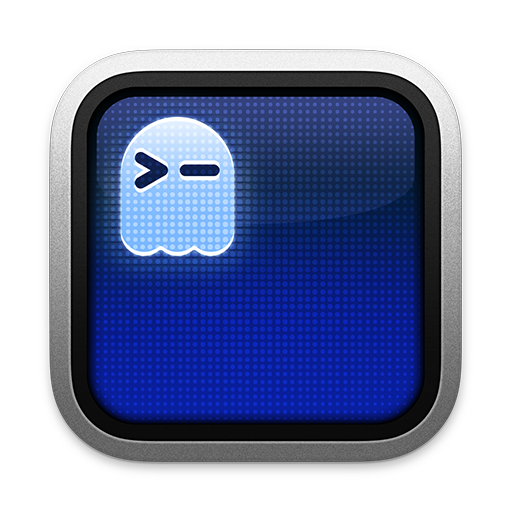
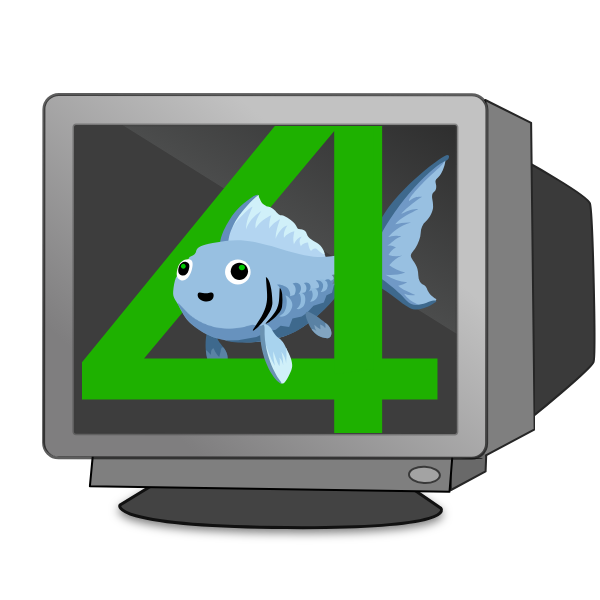
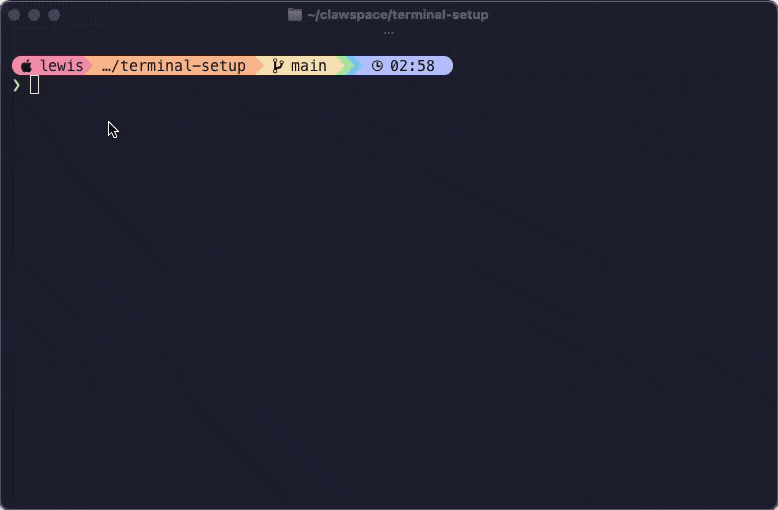

# 🖥️ terminal-setup

> 🔧 **个人 fork**，基于 [`lewislulu/terminal-setup`](https://github.com/lewislulu/terminal-setup) 定制，供本人日常使用。
> **主力环境：Ubuntu 24.04 + Zsh。** 定制架构（版本化模板 + 本地覆盖）见 [`CLAUDE.md`](CLAUDE.md)。

一键配置终端环境，支持 **macOS**、**Debian/Ubuntu** 和 **Windows (WSL)**。新机器跑一个脚本，几分钟搞定完整终端。

**🇬🇧 [English Version](README.md)**

<p align="center">
  
  &nbsp;&nbsp;
  
  &nbsp;&nbsp;
  
  &nbsp;&nbsp;
  
</p>

<p align="center">
  
</p>

## 支持平台

| 平台 | 状态 | 包管理器 |
|------|------|---------|
| 🐧 **Debian / Ubuntu** | ✅ **我的主力环境** — Ubuntu 24.04 日常使用 | apt + 内置二进制 |
| 🍎 **macOS** | ✅ 上游主力平台 — 通过 Homebrew 支持 | Homebrew |
| 🪟 **Windows (WSL)** | 🧪 继承自上游 — 未个人验证 | apt（WSL 内部） |
| 🪟 **Windows (原生)** | ⛔ 不支持 | 请先安装 WSL |

> **注意：** 这是个人配置仓库。我在 **Ubuntu 24.04 + Zsh** 上日常使用。macOS/WSL 路径继承自上游 `lewislulu/terminal-setup`（在 macOS 开发，Linux/WSL 为后加），应该仍可用，但我只主动维护 Ubuntu/Zsh 路径。

## 快速开始

### Docker 与 NVIDIA GPU

在新 Ubuntu/Debian 服务器上，先确认 `nvidia-smi` 正常，再运行 `./docker-setup.sh --gpu`。
安装源和镜像加速配置保存在 `configs/docker.json`，安装过程不拉取镜像、不迁移容器数据。
预览用 `./docker-setup.sh --gpu --dry-run`；详见 [Docker / GPU 配置说明](DOCKER_SETUP.md)。
Docker 是独立入口，日常 `sync.sh` 不会安装或重启 Docker。

### GitHub clone 后直接安装（推荐）

新服务器执行以下命令即可安装基础环境及仓库保存的实际配置，不需要传压缩包：

```bash
git clone git@github.com:foreverpine/terminal-setup.git
cd terminal-setup
./install.sh
exec zsh
```

`./install.sh --dry-run` 可先预览。支持 Debian/Ubuntu/WSL；安装依赖时使用 sudo。
终端工具、fnm/Node/pnpm、Python/uv/Conda、tmux/Zellij、Claude Code、Codex、OpenCode、
dsh、agently-cli 和 **ccm/ccc 本体及 Shell 函数**都会部署。
Starship 外观、Zellij 设置、Conda/npm 配置、CLI 使用偏好和状态栏也已入库。

`configs/server/` 存放不含密钥的共享配置；`vendor/ccm/` 保存本机使用的 ccm 脚本及语言文件。
现有 `.ccm_config`、CLI 设置等应用配置会保留，首次安装才填入默认值。
共享函数位于 `~/.config/terminal-setup/ccm.zsh`，可在后加载的 `~/.zshrc.local` 中覆盖。

API 密钥、私有网关地址、登录态及项目授权不入库。ccm 的模型偏好会部署，密钥槽位留空，
可在目标服务器的 `~/.ccm_config` 填入，也可从 `~/.zshrc.env` 导出相应变量。
Claude Code 的私有网关模型覆盖与令牌一同留在本机，仓库默认配置可直接使用正常登录。
代理和额外 PATH 仍通过 `~/.zshrc.env` 按服务器设置；已有文件不会被覆盖。

后续更新：

```bash
git pull --ff-only
./install.sh
```

只想在临时目录检查部署结果：`./install.sh --config-only --target /tmp/server-preview`。

### 可选：通过私有快照迁移完整本机设置

要让下一台服务器具备这台的基础环境，使用**服务器快照**。它同时带上安装程序、工具版本、
当前实际配置和 ccm/ccc 依赖，无需在新机器重新填写一堆空模板。

```bash
# 当前服务器：导出最新基线（输出目录必须不存在）
cd ~/terminal-setup
./migrate.sh export ./snapshots/current

# 将整个目录复制到自己的新服务器，包括其中的隐藏文件
rsync -a ./snapshots/current/ new-server:~/terminal-baseline/

# 新服务器：预览后安装
cd ~/terminal-baseline
bash install.sh --dry-run
bash install.sh
exec zsh
```

目标支持 Debian/Ubuntu/WSL，需要 Python 3、sudo 和安装源网络连接。新机器缺少 Python 3 时，
先运行 `sudo apt-get update && sudo apt-get install -y python3`。

| 基线内容 | 实际行为 |
|----------|----------|
| 终端基础 | Zsh、补全/提示/高亮、Starship、fzf、zoxide、eza、bat、fd、rg、btop、jq、tldr、delta、lazygit |
| 系统基础 | Git、curl/wget、rsync、zip/unzip、构建工具、tmux、Python/pip/venv |
| 运行环境 | fnm/Node、pnpm、uv/uvx、Miniconda、Zellij |
| 常用 CLI | Claude Code、Codex、OpenCode，以及当前基线中的 dsh、agently-cli |
| 当前配置 | 实际 `.zshrc`、Starship、代理/PATH、本机函数、Git、npm、Conda、Zellij、CLI 设置 |
| 本地依赖 | ccm/ccc 启动脚本、ccm 主脚本和语言文件、已知的 Claude 状态栏脚本、ccm 提供商配置 |

快照记录当前可读取的 fnm/Node/pnpm/uv/Zellij/CLI 版本，缺少工具时使用记录版本安装。
已有工具保持原版本；若 Node 主版本低于基线，则通过 fnm 安装记录版本并设为默认。
apt 软件版本取决于目标发行版，Miniconda 使用官方当前安装器。
这是一套基础工具和设置的复现，不复制项目、Conda 项目环境、容器数据或 GPU 驱动；Docker 继续使用独立安装入口。
SSH 私钥、CLI OAuth 登录态和 ccm 保存的账号不导出，目标机器需要重新登录相关 CLI。

`snapshots/` 已被 Git 忽略，导出目录权限为 700，配置文件权限为 600。
其中包含真实代理、API 提供商和应用配置，只应复制到自己的服务器；**不要提交快照到 Git**。
路径会在应用时改为目标用户的 HOME。代理地址保留原值；例如 `127.0.0.1` 依赖的代理服务或 SSH 隧道，
需要在目标机器可用。安装阶段的代理由启动安装命令的 shell 环境提供。

应用快照会先检查完整性和全部目标路径，再备份并替换不同的配置；相同内容不重写。
备份位于 `~/.local/state/terminal-setup/backups/server-migration-*`，保留相对路径，恢复时可按文件复制回 HOME。
这和日常 `sync.sh` 保留本机覆盖的行为不同：`migrate.sh apply` 明确要求应用所选快照。
不要直接改快照内部文件，否则完整性检查会拒绝；需调整代理等配置时，在目标应用后修改对应本机文件，
或在源机器调整后导出新的快照。普通 `sync.sh --restore` 只恢复 Zsh/Starship，不恢复快照中的其他应用配置。

```bash
# 只在临时 HOME 验证配置迁移，不装软件、不改当前用户
./migrate.sh apply ./snapshots/current --target /tmp/new-server-home --config-only

# 检查工具是否齐全；缺失时退出码非 0
python3 scripts/server_runtime.py --check
```

默认 `./install.sh` / `./sync.sh --install` 已包含运行环境、CLI 和不含密钥的实际配置，
包括 ccm 脚本。仅在需要额外迁移本机私有设置时才使用快照流程。
后续本机配置有变化时，导出到新的目录即可，例如 `./snapshots/server-2026-10-11`。

安装方式核对自 [fnm](https://github.com/Schniz/fnm#installation)、
[uv](https://docs.astral.sh/uv/getting-started/installation/)、
[Conda](https://docs.conda.io/projects/conda/en/stable/user-guide/install/linux.html)、
[Zellij](https://zellij.dev/documentation/installation.html)、
[Claude Code](https://code.claude.com/docs/en/setup#install-with-npm)、
[Codex CLI](https://developers.openai.com/codex/cli) 和 [OpenCode](https://opencode.ai/docs/#install) 官方资料。

### 日常同步 Zsh 模板

**通用安装：复制仓库后执行 `./sync.sh --install`。以后只更新模板时执行 `./sync.sh`。**

如果通过 Git 获取，先确保新服务器有此私有仓库的访问权限，并且需要的改动已提交、推送：

```bash
git clone git@github.com:foreverpine/terminal-setup.git ~/terminal-setup
cd ~/terminal-setup
./sync.sh --install
exec zsh
```

首次安装针对 Debian/Ubuntu/WSL，使用 sudo 安装 Zsh、插件、Starship 及常用 CLI，
同时安装 Node/pnpm、uv/Conda、Zellij 和常用 CLI，跳过 Ghostty 和字体，不询问可选软件。
不需要新服务器上的 GitHub 凭据时，也可以从旧服务器复制整个目录：

```bash
# 在旧服务器运行；new-server 是 SSH 别名，两端需有 rsync
rsync -av --exclude=.git --exclude=__pycache__ --exclude=.zshrc.local --exclude=.zshrc.env \
  ~/terminal-setup/ new-server:~/terminal-setup/
# 随后在新服务器运行：
cd ~/terminal-setup && ./sync.sh --install
```

后续更新有两种方式，按最初的分发方式选择：

```bash
# Git checkout：一次完成 fast-forward 拉取和配置应用
cd ~/terminal-setup && ./sync.sh --pull

# 复制/rsync 的目录：再次同步目录后应用配置；不访问网络、不需要 sudo
cd ~/terminal-setup && ./sync.sh

# 重新加载当前终端
exec zsh
```

日常修改 `configs/.zshrc` / `configs/starship.toml`，然后提交推送或复制目录。
不要直接修改部署后的 `~/.zshrc`；代理、PATH 放在 `~/.zshrc.env`，函数和别名放在 `~/.zshrc.local`。
`--pull` 遇到未提交改动或分支分叉会停止，不自动合并或覆盖代码。

| 行为 | 说明 |
|------|------|
| 同步范围 | `~/.zshrc`、`~/.config/starship.toml` |
| 本机覆盖 | 保留已有 `~/.zshrc.env` / `~/.zshrc.local`（包括软链接）；缺失时创建权限 600 的注释示例 |
| 重复执行 | 相同文件不重写，不产生多余备份 |
| 自动备份 | 改动前保存到 `~/.local/state/terminal-setup/backups/`，输出恢复命令 |
| 历史数据 | 不改动命令历史、zoxide 数据库、SSH 密钥和其他应用配置 |
| 软件安装 | 仅 `--install` 安装完整基础工具、运行环境和 CLI；配置 Git delta 并尝试设置默认 shell |

```bash
./sync.sh --dry-run                    # 预览配置改动，零写入
./sync.sh --install --dry-run          # 预览服务器安装，不执行 sudo/下载
./sync.sh --restore /path/to/backup    # 恢复该次备份中的文件，当前版本也会先备份
./sync.sh --target /tmp/zsh-preview    # 在独立目录查看部署结果
./sync.sh --local-dir ~/server-config # 导入此服务器的环境/本机覆盖文件
```

恢复只覆盖备份里存在的文件，不删除首次安装时新建的文件，也不回退 apt 安装、登录 shell 或 Git 配置。
恢复不改动 `.zshrc.env` / `.zshrc.local`。代理端口、账号和私有路径不会随仓库自动传播。
图标字体需在连接服务器的**本地终端**安装并启用 Nerd Font。
安装脚本只在 x86_64 上使用内置二进制；其他架构使用 apt 或对应架构的下载，缺少可选工具会提示。

#### 代理、PATH 与服务器配置入口

加载顺序：通用 PATH → **`.zshrc.env`** → pnpm PATH、Starship、插件、fnm 等初始化 → **`.zshrc.local`** → 语法高亮。
这两个入口由交互式 Zsh 的 `.zshrc` 加载，不是给所有脚本加载的 `.zshenv`。

| 文件 | 放什么 | 如何迁移 |
|------|--------|----------|
| `configs/.zshrc` | 通用终端行为 | 随仓库同步 |
| `~/.zshrc.env` | 代理、额外 PATH、`PNPM_HOME`、工具初始化需要的环境变量 | 为目标服务器准备后显式导入 |
| `~/.zshrc.local` | 函数、别名、ZLE widget、可选运行环境初始化 | 按需显式导入 |

环境示例见 [`configs/.zshrc.env.example`](configs/.zshrc.env.example)。路径使用 `$HOME`，避免写死用户名：

```zsh
# ~/.zshrc.env
path=("$HOME/.npm-global/bin" "$HOME/.opencode/bin" $path)
export PATH
# 仅在此服务器能访问该代理时启用；127.0.0.1 是服务器自身。
# export http_proxy="http://127.0.0.1:7890"
# export https_proxy="$http_proxy"
```

可以在仓库外按服务器各准备一个目录，明确选择要导入哪一份：

```bash
# 旧机器：准备并编辑目标服务器的配置（不要原样复制旧机器的代理地址）
mkdir -p ~/terminal-profiles/gpu-server
cp configs/.zshrc.env.example ~/terminal-profiles/gpu-server/.zshrc.env
# 编辑上面的文件；需要函数/别名时，在同目录准备 .zshrc.local
rsync -av ~/terminal-profiles/gpu-server/ new-server:~/terminal-local/

# 新服务器：先预览，再导入并安装依赖
cd ~/terminal-setup
./sync.sh --local-dir ~/terminal-local --install --dry-run
./sync.sh --local-dir ~/terminal-local --install
exec zsh
```

依赖已安装时去掉 `--install`。`--local-dir` 至少需要包含 `.zshrc.env` / `.zshrc.local` 中的一个；
只导入这两个文件，不复制它们引用的脚本。已存在且内容不同的文件会报冲突，且在改动配置或安装软件前停止；
相同文件直接保留。若已运行过普通同步并生成注释示例，应直接编辑本机文件或手动合并，再同步。
安装程序不执行这些 Zsh 文件；安装时需要的代理应先在运行安装命令的 shell 中导出。

**已有配置升级：**原 `.zshrc.local` 继续生效且不会被改写。将其中的代理和 PATH 设置移到 `.zshrc.env`，
才能在工具初始化前生效；不要在两个文件中保留相互冲突的值。其他函数和别名保留在 `.zshrc.local`。

验证同步流程（不改动当前用户配置）：

```bash
python3 -m unittest discover -s tests -v
```

### macOS

```bash
git clone https://github.com/foreverpine/terminal-setup.git
cd terminal-setup && ./setup.sh
```

### Debian / Ubuntu

```bash
git clone https://github.com/foreverpine/terminal-setup.git
cd terminal-setup && ./setup.sh
```

### Windows (WSL)

先安装 WSL（如果还没有）：
```powershell
# 在 PowerShell（管理员）中运行
wsl --install
```

然后在 WSL 中：
```bash
git clone https://github.com/foreverpine/terminal-setup.git
cd terminal-setup && ./setup.sh
```

### 选项

```bash
./setup.sh --fish       # Fish shell
./setup.sh --zsh        # Zsh + 类 Fish 插件
./setup.sh --dry-run    # 预览会做什么（不做任何改动）
```

一行命令（自动 clone）：

```bash
bash <(curl -fsSL https://raw.githubusercontent.com/foreverpine/terminal-setup/main/setup.sh)
```

## 选择你的 Shell

| | 🐟 Fish | 🐚 Zsh |
|---|---------|---------|
| **POSIX 兼容** | ❌ 自有语法 | ✅ 兼容 |
| **自动补全建议** | ✅ 内置 | ✅ 通过插件 |
| **语法高亮** | ✅ 内置 | ✅ 通过插件 |
| **Node 管理** | fnm（共享） | fnm（共享） |
| **配置文件** | `~/.config/fish/config.fish` | `~/.zshrc` |
| **适合** | 开箱即用，省心 | 写脚本，POSIX 兼容 |

## 工具栈

| 组件 | 说明 |
|------|------|
| **[Ghostty](https://ghostty.org)** | GPU 加速终端模拟器 |
| **Fish** 或 **Zsh** | Shell（你选） |
| **[Starship](https://starship.rs)** | 跨 Shell 提示符（Catppuccin Mocha 主题） |
| **MesloLGS NF** | Nerd Font，提供图标和 Powerline 字形 |
| **[bat](https://github.com/sharkdp/bat)** | 带语法高亮和行号的 `cat` |
| **[eza](https://github.com/eza-community/eza)** | 带图标、git 状态、树形视图的 `ls` |
| **[fd](https://github.com/sharkdp/fd)** | 更快更直观的 `find` |
| **[ripgrep](https://github.com/BurntSushi/ripgrep)** | 比 `grep` 快几个数量级 |
| **[fzf](https://github.com/junegunn/fzf)** | 模糊查找器（Ctrl+R / Ctrl+T / Alt+C） |
| **[btop](https://github.com/aristocratos/btop)** | 漂亮的系统监控 |
| **[zoxide](https://github.com/ajeetdsouza/zoxide)** | 智能 `cd`，学习你的习惯 |
| **[jq](https://github.com/jqlang/jq)** | JSON 处理器 |
| **[tldr](https://github.com/tldr-pages/tldr)** | 简化版 man 手册，附带示例 |
| **[delta](https://github.com/dandavison/delta)** | 带语法高亮的 git diff |
| **[lazygit](https://github.com/jesseduffield/lazygit)** | Git 终端 UI |
| **[fnm](https://github.com/Schniz/fnm)** | 快速 Node 版本管理器（Rust 编写） |
| **[Zellij](https://zellij.dev)** | 现代终端复用器（可选） |

## 脚本做了什么

1. 安装**包管理器**（macOS 用 Homebrew，Linux 用 apt）
2. 安装 **Ghostty** 终端（macOS；Linux 需手动安装）
3. 下载 **MesloLGS NF** Nerd 字体
4. 安装你选择的 **Shell** + 插件
5. 安装所有 **CLI 工具**（macOS 用 Homebrew，Linux 用 apt + GitHub releases）
6. 安装 **Starship** 提示符 + Catppuccin Mocha 配置
7. 安装 **fnm** + **Node.js** LTS（可选）
8. 安装 **Zellij** 终端复用器（可选）
9. 部署所有配置文件（已有配置会加时间戳备份）

## 平台说明

### macOS
- 完整支持，所有工具通过 Homebrew 安装
- Ghostty 作为原生 macOS 应用安装

### Debian / Ubuntu
- CLI 工具优先用 apt 安装，apt 没有的从 GitHub releases 下载（delta、lazygit、eza）
- `bat` 在 Debian 上叫 `batcat`，`fd` 叫 `fdfind` — 脚本会自动创建软链接
- 字体安装到 `~/.local/share/fonts/`
- Ghostty 不在 apt 里 — 可通过 [snap、源码编译](https://ghostty.org/docs/install) 安装，或用其他终端
- Zsh 插件通过 apt 或 git clone 安装

### Windows (WSL)
- 所有操作在 WSL 内部执行（Ubuntu/Debian 层）
- 终端模拟器在 Windows 侧运行 — 推荐 [Windows Terminal](https://aka.ms/terminal) 或 [Ghostty for Windows](https://ghostty.org)
- 脚本自动检测 WSL 环境并适配
- 如果在原生 Windows（MINGW/Git Bash）中运行，脚本会提示安装 WSL

## 别名 / 缩写

| 快捷方式 | 展开为 |
|----------|--------|
| `ls` | `eza --icons --group-directories-first` |
| `ll` | `eza -la --icons --group-directories-first` |
| `lt` | `eza --tree --icons --level=2` |
| `cat` | `bat` |
| `find` | `fd` |
| `grep` | `rg` |
| `top` | `btop` |
| `lg` | `lazygit` |

## fzf 快捷键

| 按键 | 功能 |
|------|------|
| `Ctrl+R` | 模糊搜索命令历史 |
| `Ctrl+T` | 模糊查找文件（用 `fd` 作为后端） |
| `Alt+C` | 模糊进入目录 |

## fnm — Node 版本管理

```bash
fnm install 22            # 安装 Node 22
fnm install --lts         # 安装最新 LTS
fnm default 22            # 设置默认版本
fnm use 22                # 当前 shell 切换
echo "22" > .node-version # 进入目录自动切换
```

## SSH Key 切换

两种 Shell 配置都内置了 `set-ssh-key` 函数：

```bash
set-ssh-key my-key-name     # 清空 agent，加载 ~/.ssh/my-key-name
set-ssh-key                  # key 不存在时列出所有可用 key
```

> **最佳实践：** 推荐在 `~/.ssh/config` 里用 `Host` 别名 + `IdentitiesOnly yes` 实现自动匹配。`set-ssh-key` 是兜底方案。

---

## 技术选型说明

### 为什么选 Ghostty？

GPU 加速、原生 macOS 应用、启动快、配置格式干净。iTerm2 做了太多事情导致臃肿，Ghostty 走的是现代极简路线。项目还年轻但发展很快。

### 为什么选 Starship 而不是 Powerlevel10k？

- **跨 Shell：** 同一份配置文件 Fish 和 Zsh 都能用。p10k 只支持 Zsh。
- **TOML 配置：** 声明式、可读性强。p10k 的配置是向导生成的一大堆代码。
- **Rust 二进制：** 快速，不依赖任何 Shell 框架。
- **Catppuccin 主题：** 和整个工具栈风格统一。

如果你只用 Zsh 且追求极致 prompt 速度，p10k 的 instant prompt 确实更快。但 Starship 够快了，而且通用性更好。

### 为什么同时提供 Fish 和 Zsh？

不同人有不同需求：

- **Fish：** 最佳开箱体验。自动补全、语法高亮、补全全内置，零配置。但它不兼容 POSIX，`bash` 脚本不能直接跑，有些工具假设你用 POSIX shell。
- **Zsh：** POSIX 兼容，所有 bash 脚本和一行命令都能用。装上插件（autosuggestions + syntax-highlighting）后能达到 Fish 90% 的体验。代价：依赖更多组件。

如果你经常需要跑别人的脚本 → **Zsh**。
如果你追求最干净的 Shell 体验，不介意偶尔 `bash script.sh` → **Fish**。

### 为什么 Zsh 插件用 Homebrew 装？不用 zinit/antidote/sheldon？

总共只有 3 个 Zsh 插件：`zsh-autosuggestions`、`zsh-syntax-highlighting`、`zsh-completions`。

3 个插件用插件管理器是杀鸡用牛刀：

- **zinit：** 原作者弃坑了。社区 fork（zdharma-continuum）在维护，但加了一层复杂度却没有任何收益。
- **antidote/sheldon：** 好工具，但还是多了一层。
- **Oh My Zsh：** 是框架不是插件管理器。启动时加载 100+ 文件，慢。
- **Homebrew：** 本来就装了，`brew install` + `.zshrc` 里一行 `source`。零额外依赖。

> **Linux 上：** Zsh 插件通过 apt（`zsh-autosuggestions`、`zsh-syntax-highlighting`）或 git clone 安装。

### 为什么选 fnm 而不是 nvm？

| | fnm | nvm |
|---|-----|-----|
| **语言** | Rust | Bash |
| **Shell 启动耗时** | ~1ms | ~200-400ms |
| **Fish 支持** | ✅ 原生 | ❌ 需要 nvm.fish |
| **Zsh 支持** | ✅ 原生 | ✅ 原生 |
| **自动切换** | ✅ `--use-on-cd` | ⚠️ 需要额外 hook |
| **安装方式** | `brew install fnm` / `curl` | curl 脚本 |
| **跨 Shell 共享** | ✅ 共用同一份 Node | ❌ 存储路径不同 |

### 为什么选 MesloLGS NF？

- 专为终端设计（等宽、小字号清晰）
- 包含所有 Nerd Font 字形
- Powerlevel10k 同款字体——终端实战测试
- 有 Regular/Bold/Italic/Bold Italic 四种字重

### 为什么用 git-delta？

Git 默认 diff 能用但太丑。Delta 加了语法高亮、行号、并排对比、精确到单词的变更高亮。

### 为什么用 zoxide？

带脑子的 `cd`。用几天后 `z proj` 直接跳到 ~/projects。

### 为什么用 fzf？

你能装的最有影响力的 CLI 工具。`Ctrl+R` 模糊搜索历史，`Ctrl+T` 模糊查找文件，用一周就回不去了。

## License

MIT
